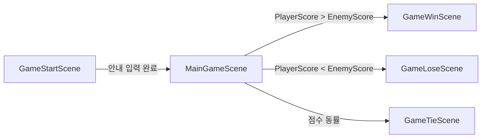
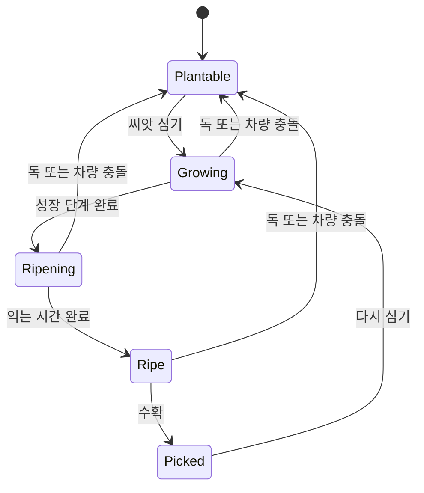

# 게임플레이 흐름

수정일: 2026-10-15  
상태: 현재 소스 구조 요약 · Editor 실행 검증 전

## 씬과 경기 수명

`ProjectSettings/EditorBuildSettings.asset`의 활성 씬 순서는 `GameStartScene`, `MainGameScene`, `GameWinScene`, `GameLoseScene`, `GameTieScene`이다.

`GameManager`가 시작 화면 안내 입력, 씬 상태, 300초 타이머, 점수 표시와 결과 씬 선택을 맡는다. 경기 중 180초가 지나면 BGM을 전환한다. `PlayerCtrl`과 `EnemyCtrl`은 각각의 점수를 `GameManager`에 반영한다.

## Player와 Enemy

- `Assets/02.Scripts/Player/PlayerCtrl.cs`는 로컬 입력과 시점·이동, 상호작용, 아이템 사용을 처리한다. 코드에서 `UnityEngine.Input`의 축·키 입력을 읽는다.
- `Assets/02.Scripts/Enemy/EnemyCtrl.cs`는 손 소품과 점수·아이템 사용을 관리한다.
- Enemy 의사결정은 Unity Behavior Graph 에셋과 `Assets/02.1BehaviorScripts/`의 사용자 정의 Action/Condition에 나뉘어 있다. 그래프 에셋의 Blackboard 연결도 동작에 영향을 주므로 C# 파일만으로 전체 AI 순서를 설명하지 않는다.
- `Assets/02.Scripts/Managers/Singleton.cs` 기반의 씬 매니저 참조가 여러 상호작용에서 사용된다. 현재 흐름을 멀티플레이어별 Player 인스턴스 격리 구조로 해석하지 않는다.

## 작물 상태

`PlayerTomatoCtrl`과 `EnemyTomatoCtrl`은 농장 슬롯별 성장 상태와 토마토 프리팹을 관리한다. 씬 Tag는 Player/Enemy 소유와 심기 가능·성장 중·익음·수확 완료 상태를 구분하며, AI 액션과 차량 충돌이 이 Tag를 사용한다.

성장 타이머는 작물에 물을 주는 동안만 진행한다. 기본 성장 간격은 2초, 마지막 성장 단계 이후 익는 대기시간은 10초다. `GrowDelayDecrease()`는 이를 각각 1초와 5초로 바꾸고 60초 뒤 기본값을 복구하도록 예약한다.

## 아이템 연결

Player 입력에서 `1`은 차량, `2`는 성장 촉진 드론, `3`은 독 드론 생성 경로를 선택한다. `PlayerBoostDrone`과 `EnemyBoostDrone`은 해당 농장의 모든 작물 컨트롤러에 성장 촉진을 요청한다. 현재 `PlayerToxicDrone`은 Player 작물 목록을, `EnemyToxicDrone`은 Enemy 작물 목록을 초기화한다. 이는 상대 농장을 공격한다는 기존 제품 설명과 다르므로 독 드론의 의도된 대상과 실제 대상은 아직 일치한다고 볼 수 없다. 차량은 반대편 작물 슬롯과의 충돌로 작물 상태를 바꾼다.

차량 스크립트에는 PIP 카메라가 있고 `UNITY_SERVER` 빌드에서는 그 카메라 구성이 빠진다. 이것은 화면 연출 분기다. 서버 권한 게임 판정이나 클라이언트 상태 동기화의 근거는 아니다.

## 네트워크 경계

현재 `Assets`의 C#에서 NGO `NetworkBehaviour`, `NetworkObject`, `NetworkVariable`, RPC 호출은 확인되지 않았다. 패키지와 Dedicated Server 최적화 설정은 프로젝트에 있지만, 현재 Player·Enemy·작물 상태를 서버가 소유하거나 여러 클라이언트에 복제한다는 보장은 아니다. 멀티플레이어 구현을 추가할 때는 점수·작물 상태·아이템 생성의 권한과 소유자별 상태를 먼저 정의하고 해당 계약을 별도 문서화한다.
