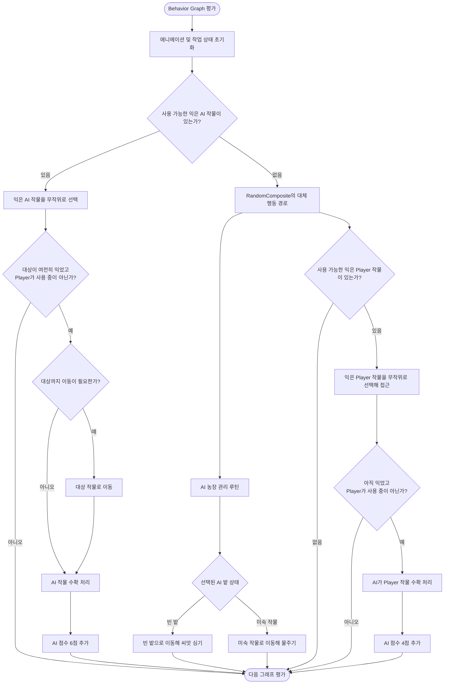

# The Boss (AI 농부) 안내

수정일: 2026-10-15  
상태: 씬·Behavior Graph·AI 스크립트 정적 확인 · AI 플레이 테스트 전

## The Boss가 가리키는 대상

`MainGameScene`의 “The Boss”는 별도의 보스전이나 체력·전투 시스템을 가진 적이 아니라, 플레이어와 점수를 겨루는 AI 농부(Enemy) 캐릭터를 가리킨다. AI는 `Assets/07.Animations/Behavior/BossBehavior.asset`의 Unity Behavior Graph 및 `Assets/02.1BehaviorScripts/`의 Action/Condition 코드로 작동한다. Player가 보스를 직접 조작하는 입력은 현재 코드에서 확인되지 않았다.

## 경기 중 확인 가능한 AI 역할

- AI 농장에서 씨앗을 심고 작물에 물을 줘 성장시킨다.
- 익은 AI 작물을 수확해 6점을 얻는다. Player 밭의 익은 작물을 수확하면 4점을 얻는다.
- AI 농장에서 익은 작물 수확을 두고 Player와 경쟁한다. Player도 가까이에서 익은 AI 작물을 수확해 4점을 얻을 수 있다.
- AI 작물 수확 시 무작위로 차량 또는 드론 보유 상태를 얻을 수 있다.
- 아이템 사용 시점은 Player의 키 입력처럼 고정되어 있지 않다. `EnemyCtrl`은 Player 아이템 사용 여부, Player 농장의 작물 상태, 무작위 결과 등을 조건으로 차량·드론을 생성한다.
- AI 차량/드론은 Behavior Graph를 사용하며, C# 액션과 그래프 에셋의 Blackboard 설정이 함께 동작한다.

## Behavior Graph 흐름

아래 그림은 `BossBehavior.asset`의 주요 분기와 연결된 C# 액션을 플레이 관점으로 요약한 것이다. 애니메이션 파라미터 초기화, `WaitForAny`의 중단 조건, 모든 예외 경로는 생략했다. `RandomComposite`가 있으므로 AI가 매 평가에서 모든 작업을 순서대로 수행한다는 뜻은 아니다.

그래프의 첫 분기는 `RipeEnemyTomato` 중 AI가 사용할 수 있는 작물이 있는지 확인한다. 없다면 농장 관리 경로와 Player 밭의 익은 작물을 노리는 경로를 `RandomComposite`로 평가한다. Player 작물 경로는 대상에 접근한 뒤 상태를 다시 확인하므로, 그 사이 작물이 수확됐거나 Player가 사용하기 시작하면 해당 작업이 중단될 수 있다. 점수는 연결된 `PickingEnemyTomatoAction`과 `ChangePlayerTomatoIntoIsPickedAction`에서 각각 확인했다.

차량과 드론을 사용하는 판단은 이 도표의 Behavior Graph 경로에 포함하지 않았다. `EnemyCtrl.EnemyCheckItemCondition()`에서 별도로 처리한다.

## 상대하는 방법

경기 제한 시간 안에 내 작물을 키워 꾸준히 수확하고, 기회가 있으면 AI가 사용 중이 아닌 익은 AI 작물도 수확한다. 차량·Toxic Drone은 현재 구현상 작물 진행도를 되돌릴 수 있다. Boost Drone은 사용자의 작물 성장 시간을 줄인다. 대상 차이는 [아이템 사용 안내](items-guide.md)에서 확인한다.

이 설명은 Behavior Graph 에셋과 액션의 정적 확인에서 요약한 AI 역할이다. 난이도, 행동 우선순위, 각 상황에서의 실제 반응은 Unity에서 경기를 실행해 검증하지 않았다. “The Boss”라는 이름만으로 보스 체력전이나 특정 난이도를 가정하지 않는다.
